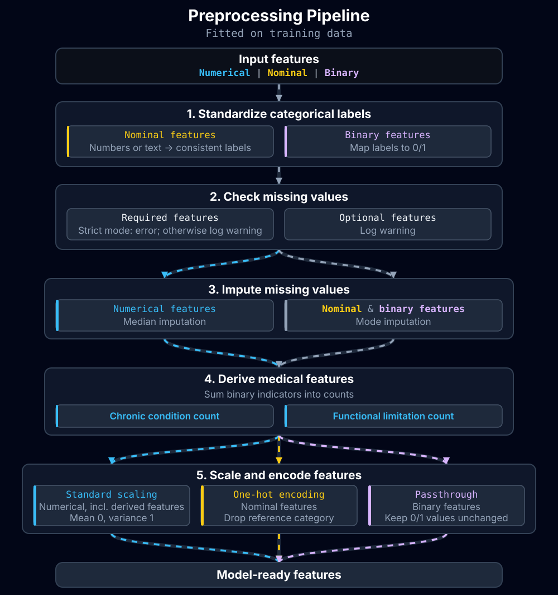
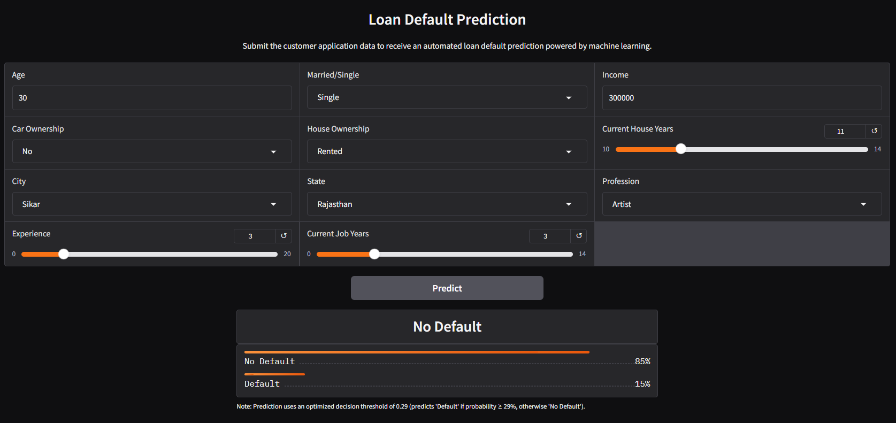
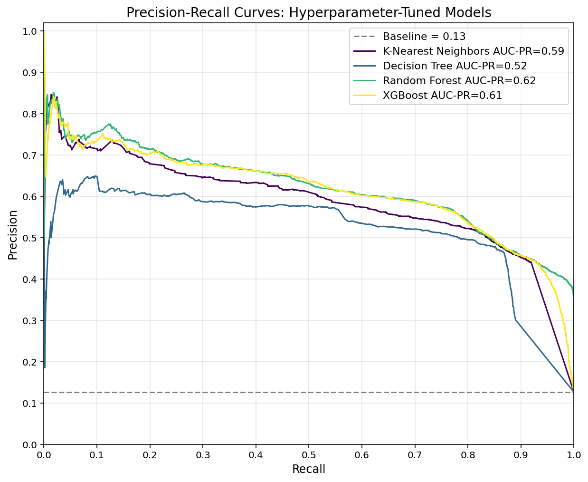
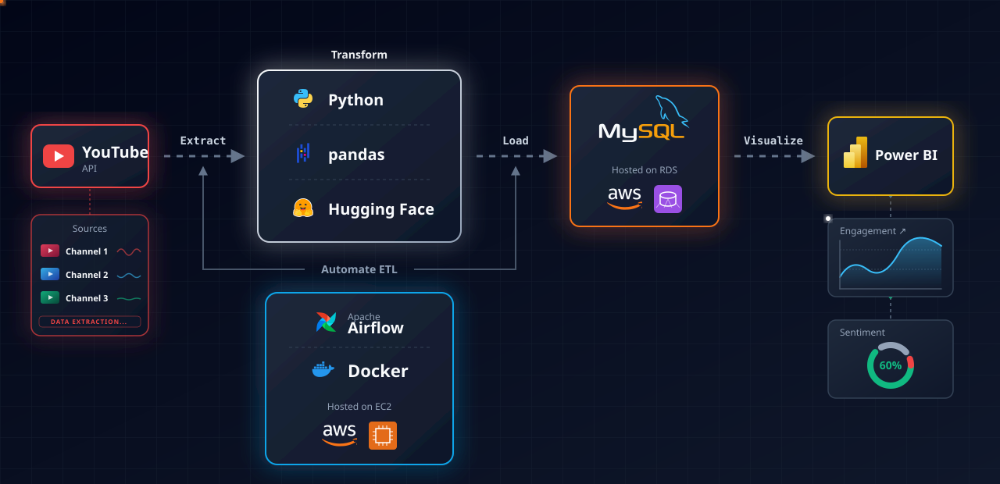
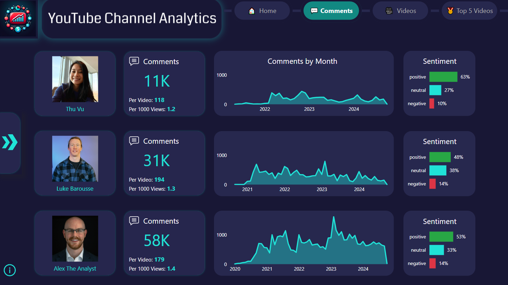
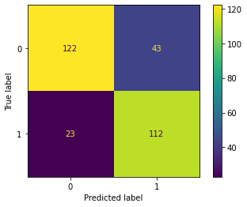
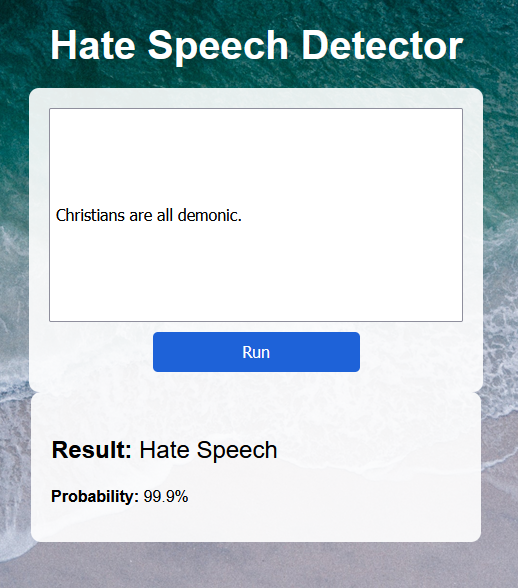

# Hi there! I'm Jens

## 👋 About Me
PhD Researcher with 8+ years in advanced statistical modeling, now applying these skills to solve complex Data Science problems. Expertise in building robust, automated end-to-end ML solutions that translate raw data into actionable insights via deployed web apps and APIs.

## 🛠️ Skills

| Category                 | Skill    |
| ------------------------ | -------- |
| Programming              | [![Python][Python-badge]][Python-url] [![MySQL][MySQL-badge]][MySQL-url] |
| Data Manipulation        | [![NumPy][NumPy-badge]][NumPy-url] [![Pandas][Pandas-badge]][Pandas-url] |
| Data Visualization       | [![Matplotlib][Matplotlib-badge]][Matplotlib-url] [![Seaborn][Seaborn-badge]][Seaborn-url] [![Plotly][Plotly-badge]][Plotly-url] [![Power BI][PowerBI-badge]][PowerBI-url] |
| AI & Machine Learning    | [![scikit-learn][scikit-learn-badge]][scikit-learn-url] [![XGBoost][XGBoost-badge]][XGBoost-url] [![SHAP][SHAP-badge]][SHAP-url] [![TensorFlow][TensorFlow-badge]][TensorFlow-url] |
| Big Data                 | [![Spark][Spark-badge]][Spark-url] |
| Web Development          | [![FastAPI][FastAPI-badge]][FastAPI-url] [![Flask][Flask-badge]][Flask-url] [![Gradio][Gradio-badge]][Gradio-url] [![Pydantic][Pydantic-badge]][Pydantic-url] |
| Version Control          | [![Git][Git-badge]][Git-url] [![GitHub][GitHub-badge]][GitHub-url] |
| MLOps                    | [![MLflow][MLflow-badge]][MLflow-url] [![DVC][DVC-badge]][DVC-url] [![Hugging Face][HuggingFace-badge]][HuggingFace-url] |
| DevOps                   | [![Docker][Docker-badge]][Docker-url] [![Airflow][Airflow-badge]][Airflow-url] [![GitHub Actions][GitHubActions-badge]][GitHubActions-url] |
| Testing                  | [![pytest][Pytest-badge]][Pytest-url] [![Selenium][Selenium-badge]][Selenium-url] |
| Cloud                    | [![AWS][AWS-badge]][AWS-url] |

## 💻 Portfolio

### [Project 1: Medical Cost Planner](https://github.com/JensBender/medical-cost-prediction)
[![Python][Python-badge]][Python-url] [![scikit-learn][scikit-learn-badge]][scikit-learn-url] [![XGBoost][XGBoost-badge]][XGBoost-url] [![SHAP][SHAP-badge]][SHAP-url] [![DVC][DVC-badge]][DVC-url] [![MLflow][MLflow-badge]][MLflow-url]

**Active Development:** Model training and evaluation are complete. The web app and API are next.

Machine learning project to help U.S. adults plan for annual out-of-pocket healthcare costs using accessible demographic and health information. Trained on MEPS 2023 survey data, **XGBoost quantile regression** was selected as the final MVP model. It provides a **plan-around estimate, typical range, and safety cushion** to help users budget for uncertain costs.

On the held-out test set, the model passes all predefined performance thresholds for launch, with a survey-weighted **median absolute error (MdAE) of $240** for the plan-around estimate. Compared with population-wide or age-group estimates, it provides better predictions, especially for typical ranges and safety cushions.

**SHAP explanations** show which answers contribute most to the plan-around estimate. Cost comparison benchmarks help users compare their estimate with typical spending for U.S. adults and their age group, while medical inflation adjustment expresses amounts in current dollars.

**Example Prediction Output**  
High cost profile: 69 years, arthritis
>
> **Your Estimated Out-of-Pocket Costs for Next Year**
>
> - 💰 **Plan around:** $895
> - 📊 **Typical range:** $400–$2,025
> - 🛡️ **Safety cushion:** $3,852
>
> 

> 
<strong>Which answers shaped your estimate?</strong> <i>(click to expand)</i>

> 
These answers made the largest contributions to your plan-around estimate:

> <table>
> <tbody>
> <tr><td><strong>Arthritis:</strong> Yes</td><td align="right">↑ +$124</td></tr>
> <tr><td><strong>Joint pain:</strong> Yes</td><td align="right">↑ +$110</td></tr>
> <tr><td><strong>High blood pressure:</strong> Yes</td><td align="right">↑ +$94</td></tr>
> <tr><td><strong>Age:</strong> 69</td><td align="right">↑ +$92</td></tr>
> <tr><td><strong>Insurance:</strong> Any private</td><td align="right">↑ +$80</td></tr>
> </tbody>
> </table>
> 

>
> 

> 
<strong>How you compare to others</strong> <i>(click to expand)</i>

> <table>
> <tbody>
> <tr><td>Your plan-around estimate</td><td align="right">$895</td></tr>
> <tr><td>Typical American</td><td align="right">$268</td></tr>
> <tr><td>Typical for ages 65+</td><td align="right">$657</td></tr>
> </tbody>
> </table>
> 

ℹ️ <strong>Preprocessing Pipeline</strong> (click to expand)

### [Project 2: Loan Default Prediction](https://github.com/JensBender/loan-default-prediction) 
[![Python][Python-badge]][Python-url] [![Pandas][Pandas-badge]][Pandas-url] [![scikit-learn][scikit-learn-badge]][scikit-learn-url] [![FastAPI][FastAPI-badge]][FastAPI-url] [![pytest][Pytest-badge]][Pytest-url] [![Docker][Docker-badge]][Docker-url] [![Hugging Face][HuggingFace-badge]][HuggingFace-url]    
Built an end-to-end machine learning solution for predicting loan defaults using customer application data, enabling financial institutions to make data-driven lending decisions and better manage credit risk. The project includes:
- **Data Preprocessing**: Engineered new features (e.g., job stability, city tier, state default rate), handled duplicates, data types, missing values, and outliers, scaled numerical features, and encoded categorical features.
- **Exploratory Data Analysis**: Analyzed distributions and relationships using descriptive statistics, correlations, and visualizations.
- **Modeling**: Trained and evaluated eight baseline models (e.g., Logistic Regression, Random Forest, XGBoost) and tuned hyperparameters. Selected a Random Forest Classifier with an optimized decision threshold, achieving an AUC-PR of 0.59, recall of 0.79, and precision of 0.51 for the default class on the hold-out test set. Visualized feature importances and showed model prediction examples.
- **Deployment**: Served the full machine learning pipeline (preprocessing and model) as a web app using a FastAPI backend and Gradio frontend within a single Docker container, hosted on Hugging Face Spaces. Automated deployment via GitHub Actions to sync web app files to Hugging Face Spaces on every push.
- **Testing**: Implemented comprehensive unit, integration, and end-to-end tests to validate individual components, their interactions, and entire user journeys.

**Model Pipeline:** [Hugging Face Hub](https://huggingface.co/JensBender/loan-default-prediction-pipeline)  
**Web App:** [Hugging Face Spaces](https://huggingface.co/spaces/JensBender/loan-default-prediction-app)

ℹ️ <strong>Model Performance</strong> (click to expand)

### [Project 3: YouTube ETL & Analytics](https://github.com/JensBender/youtube-channel-analytics)
[![Python][Python-badge]][Python-url] [![MySQL][MySQL-badge]][MySQL-url] [![Airflow][Airflow-badge]][Airflow-url] [![Docker][Docker-badge]][Docker-url] [![AWS][AWS-badge]][AWS-url] [![Hugging Face][HuggingFace-badge]][HuggingFace-url] [![Power BI][PowerBI-badge]][PowerBI-url]  
To empower YouTube content creators and marketers with actionable insights into their channel's performance, especially in comparison to related channels, I developed a comprehensive **ETL pipeline** and designed an interactive **Power BI report**. This project involved:

- **Data Extraction**: Utilized the YouTube API to gather extensive data from three selected channels, including videos and comments.
- **Data Transformation**: Performed sentiment analysis on video comments via API requests to a RoBERTa sentiment analysis model, which I deployed using Gradio on a private Hugging Face Space.
- **Data Loading**: Stored the transformed data in a MySQL database hosted on AWS.
- **Automation**: Managed the ETL workflow using Apache Airflow, Docker, and AWS.
- **Data Visualization**: Designed an interactive Power BI report to deliver insights into channel performance, featuring key metrics and comparative analysis. 

This project enables YouTube content creators to easily monitor and evaluate their channel's performance relative to their peers, allowing for more informed decision-making and strategic planning.

ℹ️ <strong>Power BI Dashboard</strong> (click to expand)

### [Project 4: Hate Speech Detection](https://github.com/JensBender/hate-speech-detection)
[![Python][Python-badge]][Python-url] [![TensorFlow][TensorFlow-badge]][TensorFlow-url] [![scikit-learn][scikit-learn-badge]][scikit-learn-url] [![NumPy][NumPy-badge]][NumPy-url] [![Pandas][Pandas-badge]][Pandas-url] [![Matplotlib][Matplotlib-badge]][Matplotlib-url] [![Flask][Flask-badge]][Flask-url]  
- **Motivation**: Develop a hate speech detector for social media comments. 
- **Data**: Utilized the [ETHOS Hate Speech Detection Dataset](https://github.com/intelligence-csd-auth-gr/Ethos-Hate-Speech-Dataset).
- **Models**: Trained and evaluated the performance of three deep learning models using TensorFlow and scikit-learn. The fine-tuned BERT model demonstrated superior performance (78.0% accuracy) compared to the SimpleRNN (66.3%) and LSTM (70.7%) models.  
- **Deployment**: Prepared the fine-tuned BERT model for production by integrating it into a web application and an API endpoint using the Flask web framework.

| Fine-tuned BERT: Confusion Matrix | Model Deployment | 
| ------------------ | ------------------ | 
|  |  |

### More Projects
- **[Rental Price Prediction](https://github.com/JensBender/rental-price-prediction):** Predicting Singapore rental prices using XGBoost. Includes web scraping of properties, feature engineering via Google Maps API, and a Dockerized Flask application for deployment.
- **[Machine Learning Template](https://github.com/JensBender/machine-learning-template):** A versatile, ready-to-use machine learning template for tabular data. Streamlines EDA, data preprocessing, and modeling for regression and classification.
- **[ChatGPT Cover Letter Generator](https://github.com/JensBender/chatgpt-cover-letter-generator):** LLM-driven cover letter generator. Transforms job postings into tailored applications using the OpenAI API and Web Scraping.

## 🏅 Certifications & Courses

**ML in Production** | DeepLearning.AI | May 2025  
*Skills: MLOps · Data-Centric ML Lifecycle · Error Analysis*

**Hugging Face** | DeepLearning.AI | July 2024  
*Skills: Transformers · Multimodal AI · Gradio · HF Hub & Spaces*

**Data Engineering Foundations** | DeepLearning.AI | June 2024  
*Skills: Requirements Gathering · Tech Specs*

**IBM Data Engineering** | IBM | May 2024  
*Skills: ETL · Bash · Apache Airflow (DAGs)*

**Advanced SQL: MySQL for Ecommerce & Web Analytics** | Udemy | February 2024 | [🔗 Certificate](https://www.udemy.com/certificate/UC-ac04dd78-4589-4b2e-a863-7722cd78ec2f/)  
*Skills: MySQL · Business Intelligence · Data Analysis · Subqueries · Temporary Tables*

**A/B Testing** | Google | February 2024  
*Skills: Experimental Design · Metric Selection · Power Analysis · Sanity Checks*

**AWS Certified Cloud Practitioner** | AWS | January 2024 | [🔗 Certificate](https://www.credly.com/badges/3287f8a9-0dcd-48d2-afc3-c255faf027bc/public_url)  
*Skills: Amazon Web Services (AWS) · Cloud Concepts · Security & Compliance · Billing & Pricing*

**Ultimate AWS Certified Cloud Practitioner CLF-C02** | Udemy | January 2024 | [🔗 Certificate](https://www.udemy.com/certificate/UC-2090637d-9845-42f3-9f7b-97195874331a/)  
*Skills: Amazon Web Services (AWS) · Identity and Access Management (IAM) · Elastic Compute Cloud (EC2) · Simple Storage Service (S3) · Virtual Private Cloud (VPC) · CloudWatch · Database & Analytics*

**Spark and Python for Big Data with PySpark** | Udemy | January 2024 | [🔗 Certificate](https://www.udemy.com/certificate/UC-27da6f52-bc5f-4e72-bc5b-c2cd488566b0/)  
*Skills: Apache Spark · PySpark · Spark DataFrames · MLlib · Amazon Web Services (AWS) · Databricks*

**Microsoft Power BI Data Analyst** | Udemy | November 2023 | [🔗 Certificate](https://www.udemy.com/certificate/UC-eb56c820-8c91-4e03-8c57-efdc8c570c6b/)  
*Skills: Power BI · Power Query · Data Analysis Expressions (DAX) · Data Modeling · Interactive Dashboards*

**Product Management for AI** | 365 Data Science | November 2023  
*Skills: AI Strategy · UX · Stakeholder Management*

**LLM App Development** | OpenAI & DeepLearning.AI | June 2023  
*Skills: OpenAI API · Prompt Engineering*

**Deep Learning** | alfatraining Bildungszentrum GmbH | April 2023  
*Skills: TensorFlow · Neural Networks · Convolutional Neural Networks (CNN) · Computer Vision · Recurrent Neural Networks (RNN) · Long Short-Term Memory (LSTM) · Natural Language Processing (NLP) · Time Series Analysis*

**Machine Learning by Stanford University & DeepLearning.AI** | Coursera | April 2023 | [🔗 Certificate](https://coursera.org/share/1c62950a6100b0426d454b652e77498c)  
*Skills: Linear & Logistic Regression · Neural Networks · Recommender Systems · Reinforcement Learning*

**Python for Machine Learning & Data Science Masterclass** | Udemy | March 2023 | [🔗 Certificate](https://www.udemy.com/certificate/UC-4de79ac0-2282-45c9-93e1-a7cb6f812592/)  
*Skills: scikit-learn · Pandas · NumPy · Matplotlib · Seaborn · Random Forest · Gradient Boosting · Support Vector Machines (SVM) · DBSCAN*

**Machine Learning** | alfatraining Bildungszentrum GmbH | February 2023  
*Skills: Regression · K-Nearest Neighbors (KNN) · Decision Trees · Random Forest · Support Vector Machines (SVM) · Clustering · Principal Component Analysis (PCA) · Feature Engineering · Model Evaluation*

**The Ultimate MySQL Bootcamp: Go from SQL Beginner to Expert** | Udemy | December 2022 | [🔗 Certificate](https://www.udemy.com/certificate/UC-e324e4f7-95ba-4894-b8e0-65229ff5e2dc)  
*Skills: MySQL · Database Schemas · SQL Joins · Aggregate Functions · Window Functions*

**The Git & GitHub Bootcamp** | Udemy | September 2022  
*Skills: Git · GitHub · Version Control · Branching · Merging · Pull Requests*

**100 Days of Code: The Complete Python Pro Bootcamp** | Udemy | April 2022 – November 2022  
*Skills: Python · OOP · Flask · Web Scraping (Beautiful Soup, Selenium) · APIs (Requests) · Automation*

## 👨‍💻 GitHub Statistics

  

## ©️ Credits
<small>Profile banner GIF based on the video by [RDNE Stock project](https://www.pexels.com/video/business-analytics-presentation-7947451/) from Pexels</small>

<!-- MARKDOWN LINKS -->
[Airflow-badge]: https://img.shields.io/badge/Apache%20Airflow-017CEE?style=for-the-badge&logo=Apache%20Airflow&logoColor=white
[Airflow-url]: https://airflow.apache.org/
[AWS-badge]: https://img.shields.io/badge/AWS-%23FF9900?style=for-the-badge&logo=amazonaws&logoColor=white
[AWS-url]: https://aws.amazon.com/
[ChatGPT-badge]: https://img.shields.io/badge/chatGPT-74aa9c?style=for-the-badge&logo=openai&logoColor=white
[ChatGPT-url]: https://chatgpt.com/
[Docker-badge]: https://img.shields.io/badge/docker-%230db7ed.svg?style=for-the-badge&logo=docker&logoColor=white
[Docker-url]: https://www.docker.com/
[DVC-badge]: https://img.shields.io/badge/DVC-13ADC7?style=for-the-badge&logo=dvc&logoColor=white
[DVC-url]: https://dvc.org/
[FastAPI-badge]: https://img.shields.io/badge/FastAPI-009688?style=for-the-badge&logo=fastapi&logoColor=white
[FastAPI-url]: https://fastapi.tiangolo.com/
[Flask-badge]: https://img.shields.io/badge/flask-%23000.svg?style=for-the-badge&logo=flask&logoColor=white
[Flask-url]: https://flask.palletsprojects.com/en/2.3.x/
[Git-badge]: https://img.shields.io/badge/git-%23F05033.svg?style=for-the-badge&logo=git&logoColor=white
[Git-url]: https://git-scm.com/
[GitHub-badge]: https://img.shields.io/badge/github-%23121011.svg?style=for-the-badge&logo=github&logoColor=white
[GitHub-url]: https://github.com/
[GitHubActions-badge]: https://img.shields.io/badge/github%20actions-%236E5494.svg?style=for-the-badge&logo=githubactions&logoColor=white
[GitHubActions-url]: https://github.com/features/actions
[Gradio-badge]: https://img.shields.io/badge/Gradio-fc7404?style=for-the-badge&logo=gradio&logoColor=white
[Gradio-url]: https://gradio.app
[HuggingFace-badge]: https://img.shields.io/badge/Hugging%20Face-ffcc00?style=for-the-badge&logo=huggingface&logoColor=black
[HuggingFace-url]: https://huggingface.co/
[Matplotlib-badge]: https://img.shields.io/badge/Matplotlib-%23DDDDDD?style=for-the-badge&logo=
[Matplotlib-url]: https://matplotlib.org/
[MLflow-badge]: https://img.shields.io/badge/MLflow-0194E2?style=for-the-badge&logo=MLflow&logoColor=white
[MLflow-url]: https://mlflow.org/
[MySQL-badge]: https://img.shields.io/badge/mysql-%2300f.svg?style=for-the-badge&logo=mysql&logoColor=white
[MySQL-url]: https://www.mysql.com/
[NumPy-badge]: https://img.shields.io/badge/numpy-%23013243.svg?style=for-the-badge&logo=numpy&logoColor=white
[NumPy-url]: https://numpy.org/
[Pandas-badge]: https://img.shields.io/badge/pandas-%23150458.svg?style=for-the-badge&logo=pandas&logoColor=white
[Pandas-url]: https://pandas.pydata.org/
[PowerBI-badge]: https://img.shields.io/badge/power_bi-F2C811?style=for-the-badge&logo=
[PowerBI-url]: https://powerbi.microsoft.com/en-us/
[Plotly-badge]: https://img.shields.io/badge/Plotly-%233F4F75.svg?style=for-the-badge&logo=plotly&logoColor=white
[Plotly-url]: https://plotly.com/python/
[Pydantic-badge]: https://img.shields.io/badge/Pydantic-3776AB?style=for-the-badge&logo=pydantic&logoColor=white
[Pydantic-url]: https://docs.pydantic.dev/
[Python-badge]: https://img.shields.io/badge/python-3670A0?style=for-the-badge&logo=python&logoColor=ffdd54
[Pytest-badge]: https://img.shields.io/badge/pytest-%23F0F0F0?style=for-the-badge&logo=pytest&logoColor=2f9fe3
[Pytest-url]: https://docs.pytest.org/
[Python-url]: https://www.python.org/
[scikit-learn-badge]: https://img.shields.io/badge/scikit--learn-%23F7931E.svg?style=for-the-badge&logo=scikit-learn&logoColor=white
[scikit-learn-url]: https://scikit-learn.org/stable/
<!-- Seaborn logo: https://github.com/mwaskom/seaborn/blob/master/doc/_static/logo-mark-darkbg.svg (PNG export). -->
[Seaborn-badge]: https://img.shields.io/badge/seaborn-%230C4A89.svg?style=for-the-badge&logo=
[Seaborn-url]: https://seaborn.pydata.org/
[Selenium-badge]: https://img.shields.io/badge/selenium-%43B02A.svg?style=for-the-badge&logo=selenium&logoColor=white
[Selenium-url]: https://www.selenium.dev/
[Spark-badge]: https://img.shields.io/badge/Apache%20Spark-E25A1C.svg?style=for-the-badge&logo=Apache-Spark&logoColor=white
[Spark-url]: https://spark.apache.org/
[TensorFlow-badge]: https://img.shields.io/badge/TensorFlow-%23FF6F00.svg?style=for-the-badge&logo=TensorFlow&logoColor=white
[TensorFlow-url]: https://www.tensorflow.org/
<!-- XGBoost rocket: https://xgboost.ai/images/logo/xgboost-logo.svg (recolored white). -->
[XGBoost-badge]: https://img.shields.io/badge/XGBoost-0068C7?style=for-the-badge&logo=
[XGBoost-url]: https://xgboost.readthedocs.io/
<!-- SHAP symbol: https://github.com/shap/shap/blob/master/docs/artwork/shap_logo_scratch.ai -->
[SHAP-badge]: https://img.shields.io/badge/SHAP-343131?style=for-the-badge&logo=
[SHAP-url]: https://shap.readthedocs.io/
